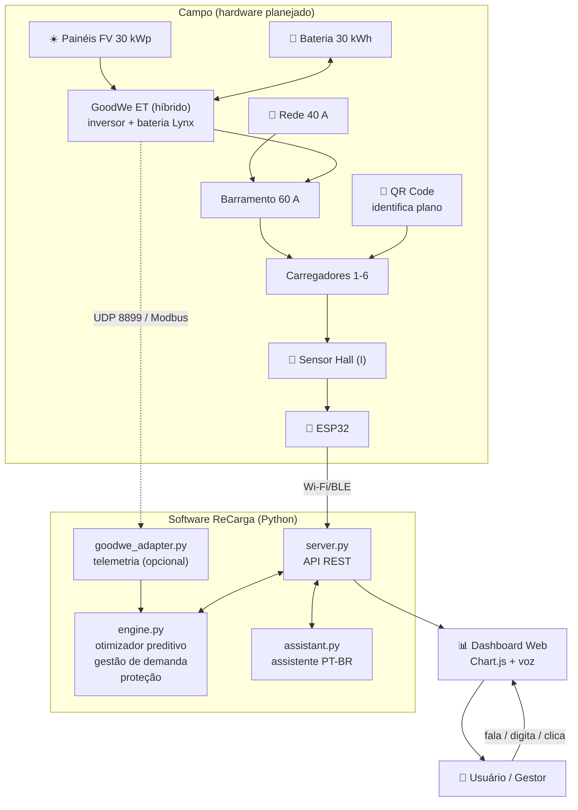

# ⚡ ReCarga — Recarga veicular inteligente com solar, bateria e IA preditiva

> **Sprint 4 — Solução Final Integrada e Inovadora · Desafio GoodWe**

Sistema de gerenciamento de recarga de veículos elétricos que integra **geração solar → armazenamento em bateria → gerenciamento de demanda → monitoramento inteligente**, com otimizador preditivo, proteção por detecção de anomalias, assistente virtual por voz e relatório de impacto ambiental e financeiro.

| | |
|---|---|
| 🎬 **Vídeo técnico (YouTube, não listado)** | **[COLE AQUI O LINK DO VÍDEO]** |
| 📦 **Repositório** | **[COLE AQUI O LINK DO REPOSITÓRIO]** |
| 📄 **Documentação em PDF** | [`docs/ReCarga_Documentacao_Sprint4.pdf`](./docs/ReCarga_Documentacao_Sprint4.pdf) |

---

## 👥 Equipe

| Nome | RM |
| --- | --- |
| Olavo Dadario Vianna Barreto | 569272 |
| Mateus de Oliveira Fernandes Neves | 572431 |
| Angela Sousa Takezawa | 570797 |
| Paulo Henrique Lira Bilac de Araujo | 569496 |
| Pedro Soares de Souza | 571285 |
| Jhon Cutile Titirico | 571976 |

---

## 📑 Sumário

1. [O que mudou da Sprint 3 para a Sprint 4](#-o-que-mudou-da-sprint-3-para-a-sprint-4)
2. [Dashboard em funcionamento (prints reais)](#-dashboard-em-funcionamento-prints-reais)
3. [Arquitetura final e integração dos sistemas](#-arquitetura-final-e-integração-dos-sistemas)
4. [Os diferenciais inovadores](#-os-diferenciais-inovadores)
5. [Tecnologias GoodWe e como a solução se conecta a elas](#-tecnologias-goodwe-e-como-a-solução-se-conecta-a-elas)
6. [Alinhamento ao desafio GoodWe e à disciplina](#-alinhamento-ao-desafio-goodwe-e-à-disciplina)
7. [Pensamento Computacional no projeto](#-pensamento-computacional-no-projeto)
8. [Resultados quantitativos e qualitativos](#-resultados-quantitativos-e-qualitativos)
9. [Avaliação crítica: sustentabilidade, inovação e limitações](#-avaliação-crítica-sustentabilidade-inovação-e-limitações)
10. [Como executar](#-como-executar)
11. [Estrutura do repositório](#-estrutura-do-repositório)
12. [Referências, frameworks e ferramentas](#-referências-frameworks-e-ferramentas)

---

## 🆕 O que mudou da Sprint 3 para a Sprint 4

A Sprint 3 entregou o motor de demanda alimentado por geração solar. Esta sprint o transforma em um sistema **completo** (geração + armazenamento + uso) e **inteligente**, e corrige os pontos apontados no feedback.

**Novidades**

| Área | Sprint 3 | Sprint 4 |
| --- | --- | --- |
| Armazenamento | — | Bateria de 30 kWh (SOC, carga/descarga, perdas de 5% por sentido, reserva técnica de 15%) |
| Decisão | Regra fixa (solar soma capacidade) | **Otimizador preditivo**: prevê a geração, estima a demanda da ponta e reserva bateria para ela (*peak shaving*) |
| Tarifa | Preço fixo ao usuário | Tarifa da rede por horário (ponta × fora de ponta) → custo real, economia e margem |
| Segurança | — | **Proteção por sobrecorrente**: compara corrente medida (sensor Hall) × comandada e desarma a vaga |
| Interface | Cards + 2 gráficos | + diagrama de **fluxo de energia** animado, previsão solar × demanda, decisões explicadas em texto, relatório de impacto, exportação CSV |
| Interação | Cliques | + **assistente virtual em português** (texto e voz) |
| Integração GoodWe | Conceitual | **Adaptador de telemetria** `goodwe_adapter.py` (leitura de inversor real, opcional) |
| Validação | Visual | **17 testes automatizados** + simulação de 30 dias com 4 cenários comparáveis |

**Correções do feedback da Sprint 3**

| Feedback | O que foi feito |
| --- | --- |
| *Incluir prints do dashboard no README* | Seção [prints reais](#-dashboard-em-funcionamento-prints-reais), capturados automaticamente do sistema rodando (`docs/img/`) |
| *Corrigir o pico solar informado (código usa 30 kWp, não 6 kW)* | Todo o texto e diagramas agora dizem **30 kWp** (constante `SOLAR_KWP`). Além disso, o antigo "bônus solar" era limitado a 20 A; o limite agora é explícito: **barramento de 60 A** (`BUS_LIMIT_A`) |
| *Organizar a estrutura de pastas* | Estrutura reorganizada (`app/`, `simulation/`, `tests/`, `docs/`), sem o aninhamento `Dashboard/Dashboard/` e sem a mistura `Static`/`template` |
| *Acrescentar a conexão com Pensamento Computacional* | Seção dedicada: [decomposição, padrões, abstração e algoritmos](#-pensamento-computacional-no-projeto) mapeados a trechos reais do código |

**Inconsistências da Sprint 3 que encontramos e corrigimos por conta própria**

* O README da Sprint 3 descrevia um contador de *"sobrecargas evitadas graças ao reforço solar"* que **não existia no código**. Agora ele existe (`overload_avoided_local`) e é coberto por teste.
* A energia era integrada com Δt de 1,5 s **reais** enquanto o "dia solar" era acelerado, o que tornava kWh e R$ minúsculos e impediria qualquer dinâmica de bateria. Agora 1 ciclo = **6 minutos simulados** (Δt = 0,1 h) e 1 dia = 240 ciclos.
* O pré-pago ficava restrito à rede; agora a geração local também o atende, e o pós-pago é o plano "flexível" que o otimizador adia.

---

## 🖼️ Dashboard em funcionamento (prints reais)

Capturas do sistema em execução (`python app/server.py`), em horários simulados diferentes, no modo **Auto (IA)**.

### Meio-dia — sol alto, bateria cheia, excedente injetado na rede


### 19h (horário de ponta) — bateria assume a carga e evita a tarifa cara


### Fluxo de energia na ponta — solar 0 kW, bateria descarregando, rede 0 kW


### Assistente virtual — perguntas em linguagem natural


### Proteção — falha injetada no sensor Hall: leitura em 160% do comando, vaga desarmada


### Referência (modo "Só rede") no mesmo horário: sem solar nem bateria


Outros estados capturados: [pré-ponta (reserva de bateria)](./docs/img/dashboard_pre_ponta.png) · [proteção atuando](./docs/img/dashboard_protecao.png).

---

## 🏗️ Arquitetura final e integração dos sistemas



<details>
<summary>Versão em imagem (caso o Mermaid não renderize)</summary>


</details>

> **O que é real e o que é simulado.** O **software** (motor, API, dashboard, assistente, otimizador, testes) é real e executável. O **hardware** (painéis, inversor, bateria, sensores Hall, ESP32) é **simulado** pelo motor, que gera os mesmos dados que viriam dos equipamentos. O adaptador GoodWe permite trocar a geração e o SOC simulados por leituras reais de um inversor, mas **não foi validado em equipamento físico** (ver [limitações](#-avaliação-crítica-sustentabilidade-inovação-e-limitações)).

### Módulos

| Arquivo | Responsabilidade |
| --- | --- |
| `app/engine.py` | Núcleo: geração solar, bateria, gestão de demanda, otimizador, proteção, tarifa, contabilidade de energia/CO₂/R$. Só biblioteca padrão. Desacoplado do servidor (testável e simulável sem interface). |
| `app/server.py` | Servidor `http.server` + API REST (`/api/state`, `/api/assistant`, `/api/report.csv`, controles). |
| `app/assistant.py` | Assistente virtual em PT-BR (NLU por regras) que consulta e **controla** o motor. |
| `app/goodwe_adapter.py` | Telemetria opcional de inversor GoodWe via biblioteca `goodwe`. |
| `app/static/app.js` · `templates/index.html` · `style.css` | Dashboard (HTML + CSS + JS + Chart.js), SVG de fluxo de energia, voz (Web Speech API). |
| `simulation/run_scenarios.py` | Simulação de 30 dias, 4 cenários, gera tabelas e gráficos. |
| `tests/test_engine.py` | 17 testes: invariantes físicas, balanço de energia, proteção, otimizador, assistente, telemetria. |

### Ciclo de controle (a cada 6 min simulados / 1,5 s reais)

1. **Geração:** `P_solar = 30 kWp × sen(π·(h−6)/12) × clima_do_dia × ruído` (ou leitura real do inversor).
2. **Previsão:** a nebulosidade é estimada por média móvel exponencial (EMA) da razão geração medida ÷ céu limpo; a previsão das próximas 24 h é a curva de céu limpo × essa estimativa.
3. **Política da bateria** (conforme o modo) → define quanta energia ela pode entregar neste ciclo.
4. **Capacidade disponível:** `min(60 A, 40 A da rede + (solar + bateria) / 230 V)`.
5. **Gestão de demanda:** pré-pago é atendido primeiro; o restante da capacidade é dividido entre os pós-pagos (limitados ou enfileirados se faltar).
6. **Proteção:** corrente medida ÷ comandada > 1,25 → vaga desarmada por 1 h simulada.
7. **Balanço de potência:** de onde veio cada kW (solar direta → bateria → rede); excedente carrega a bateria e, se cheia, é injetado na rede.
8. **Contabilidade:** `P = V·I`, `E = P·Δt`, `Custo = E × tarifa`; CO₂ evitado = (solar + bateria) × 0,117 kg/kWh; economia = custo da rede se fosse só rede − custo real.
9. **API:** o dashboard consome `/api/state` e redesenha tudo (inclusive a explicação textual das decisões).

---

## 🚀 Os diferenciais inovadores

### 1. 🧠 Otimizador preditivo de bateria (*peak shaving*)

No modo **Auto (IA)**, antes do horário de ponta (18h–21h, tarifa 3× mais cara) o sistema **estima a energia que a ponta vai exigir** (média móvel da demanda × 3 h × 0,8) e **reserva** essa energia na bateria, mesmo que isso signifique comprar rede barata às 17h. Na ponta, a bateria cobre a carga toda. Se a bateria esgota durante a ponta, o otimizador reduz o pós-pago em 30% para limitar a compra de energia cara.

```text
se modo == auto e bateria disponível:
    se é ponta:                 bateria cobre toda a carga que puder      (peak shaving)
    senão se hora < 18h:        reserva = SOC_mín + demanda_média × 3 h × 0,8   (previsão)
                                bateria só entrega energia acima da reserva
se é ponta e bateria esgotada:  pós-pago × 0,7
```

O gráfico abaixo (um dia típico simulado) mostra o efeito: às 17h–18h a bateria **não** é usada (rede fora de ponta, mais barata); às 18h ela assume e só é esgotada perto das 20h30.


### 2. 🛡️ Proteção por detecção de anomalia no sensor Hall

O motor compara a corrente **medida** (sensor Hall) com a **comandada**. Em condições normais a medida fica entre 92% e 100% do comando (o carregador respeita o *setpoint*). Acima de 125%, a vaga é **desarmada por 1 h simulada**, um alerta é registrado e o motor redistribui a corrente. O botão *"⚡ simular falha no sensor"* demonstra isso ao vivo. O teste `test_normal_jitter_never_trips` garante **zero falsos positivos** em 5 dias simulados.

### 3. 🎙️ Assistente virtual em português (texto e voz)

Comandos e perguntas em linguagem natural, digitados ou **falados** (reconhecimento e síntese de voz do navegador, Web Speech API, `pt-BR`):

| Tipo | Exemplos |
| --- | --- |
| Consultas | "como está a bateria?" · "quanto CO2 evitamos?" · "qual a economia?" · "qual a tarifa agora?" · "status geral" |
| Comandos | "desligue a vaga 3" · "mude a vaga 2 para pré-pago" · "ative o modo IA" · "vá para as 18 horas" |
| Proativo | "o que você recomenda?" → ex.: *"Há 16 kW de excedente solar sendo injetado: conecte um veículo na vaga #5"* |

O endpoint `POST /api/assistant {"text": "..."}` devolve JSON, o que o deixa **pronto para ser chamado por um webhook** de Alexa/Google Assistant. *Essa ponte não está implementada nesta versão.*

### 4. 📊 Visualização e explicabilidade

* **Fluxo de energia animado** (Solar ↔ Bateria ↔ Rede ↔ Carregadores ↔ Exportação) em SVG.
* **Origem da energia** (solar/bateria/rede empilhados) com a curva de SOC.
* **Previsão solar × demanda esperada** das próximas 24 h.
* **Painel "Decisões do otimizador"**: cada decisão aparece em texto (*"Previsão de ponta às 18h: preservando 85% de SOC"*), tornando a automação auditável.
* **Relatório de impacto** (% renovável, CO₂, economia, margem) e **exportação CSV** da sessão.

### 5. ⏩ Controles de demonstração

Seletor de modo (Auto / Solar-first / Só rede), salto de horário e velocidade 1×/3×/10×: permitem comparar estratégias **no mesmo instante do dia** durante o vídeo.

---

## 🔌 Tecnologias GoodWe e como a solução se conecta a elas

A tabela mostra o equipamento GoodWe equivalente a cada elemento da solução e **o que está efetivamente implementado**.

| Elemento no ReCarga | Equivalente GoodWe / compatível | Papel no sistema | Status nesta entrega |
| --- | --- | --- | --- |
| Geração fotovoltaica 30 kWp | Inversor híbrido **GoodWe série ET** | Converte CC→CA, mede a produção FV | **Simulada** (curva solar); leitura real via adaptador |
| Bateria 30 kWh | Baterias de lítio **GoodWe Lynx** (compatíveis com a série ET) | Armazena o excedente solar e cobre a ponta | **Simulada** (SOC, perdas, limites); SOC real via adaptador |
| Telemetria | Protocolo UDP/Modbus dos inversores GoodWe + biblioteca open-source `goodwe` (Python) | Leitura de `ppv`, `battery_soc`… | **Implementada** em `goodwe_adapter.py`, validada com objeto simulado, **não testada em equipamento físico** |
| Carregadores 1–6 | Wallbox **GoodWe HCA** (carregador veicular) | Entrega a corrente comandada ao veículo | **Simulados** |
| Monitoramento | **SEMS Portal** (nuvem GoodWe) | Visualização do ativo | O dashboard ReCarga **complementa** o SEMS com a camada de **gestão de recarga**, que ele não tem |
| Medição de corrente | Sensor de efeito Hall + ESP32 | Mede `I` por vaga | **Simulado** (mesmo formato de dado) |

> Os nomes de séries/protocolos acima devem ser conferidos na documentação oficial da GoodWe para o modelo específico escolhido; esta entrega usa dimensionamentos **ilustrativos**.

**Por que essas escolhas (justificativa técnica)**

| Tecnologia | Justificativa |
| --- | --- |
| Inversor híbrido + bateria | Só um inversor híbrido permite **armazenar** o excedente solar em vez de injetá-lo na rede por valor baixo, base do *peak shaving*. |
| Bateria de lítio | Alta eficiência de ida-e-volta (modelada em ≈ 90%) e ciclagem profunda; a reserva de 15% protege a vida útil. |
| Sensor Hall | Mede corrente sem resistência em série (não invasivo), barato, compatível com ADC de microcontrolador. |
| ESP32 | Wi-Fi/Bluetooth integrados e baixo custo. |
| QR Code | Identificação do usuário/plano sem sistema de autenticação complexo nesta fase. |
| Python (biblioteca padrão) | Zero dependências: qualquer máquina executa o protótipo. |
| API REST/JSON | Desacopla backend e frontend: o mesmo dashboard consome dados simulados ou reais. |

---

## 🎯 Alinhamento ao desafio GoodWe e à disciplina

Como cada parte da solução resolve um ponto-chave do desafio:

| Requisito do desafio | Como a solução atende | Onde ver |
| --- | --- | --- |
| **Geração** de energia renovável | Solar de 30 kWp modelada hora a hora, com clima variável e previsão | `engine.py` · card "Geração renovável" |
| **Armazenamento** | Bateria de 30 kWh com SOC, perdas, limites de potência e reserva técnica | card de bateria · fluxo de energia |
| **Uso** otimizado | Gestão de demanda com prioridade pré-pago, geração local ampliando a capacidade e otimizador que desloca energia para a ponta | motor + decisões do otimizador |
| **Monitoramento inteligente** | Dashboard em tempo real, alertas, proteção por anomalia, previsão, assistente e relatório CSV | dashboard completo |
| **Tecnologias compatíveis GoodWe** | Arquitetura mapeada para inversor ET, baterias Lynx, wallbox HCA, SEMS; adaptador de telemetria `goodwe` | seção [GoodWe](#-tecnologias-goodwe-e-como-a-solução-se-conecta-a-elas) |
| **Sustentabilidade** | 78,8% do consumo renovável, 384 kg de CO₂ evitados em 30 dias | [Resultados](#-resultados-quantitativos-e-qualitativos) |
| **Automação e eficiência** | Decisões sem intervenção humana (controle de corrente, reserva de bateria, desarme por falha) | testes + simulação |

**Conexão com os conteúdos da disciplina**

* **Energia renovável e eficiência energética:** modelagem da curva solar, perdas da bateria, deslocamento de carga e redução de picos.
* **Automação e sistemas de gerenciamento de energia (EMS):** o motor é uma malha de controle que redistribui corrente respeitando limites físicos, o mesmo princípio de EMS reais.
* **IoT e sistemas embarcados:** cadeia sensor Hall → ESP32 → servidor → dashboard.
* **Modelagem matemática:** `P = V·I`, `E = P·Δt`, `Custo = E × tarifa`, `P_solar = P_pico·sen(π·fração_do_dia)`, EMA para previsão, balanço de potência a cada ciclo.
* **Interfaces e visualização de dados:** Chart.js, SVG dinâmico, relatório exportável.

---

## 🧩 Pensamento Computacional no projeto

Os quatro pilares do Pensamento Computacional aparecem de forma concreta no código:

| Pilar | Como foi aplicado | Evidência |
| --- | --- | --- |
| **Decomposição** | O problema "gerenciar uma estação de recarga solar" foi quebrado em subproblemas independentes: *gerar* (solar), *prever* (EMA + curva), *armazenar* (bateria), *alocar* (demanda/prioridade), *proteger* (anomalia), *contabilizar* (kWh/R$/CO₂), *interagir* (API + dashboard + assistente). Cada um é uma função/módulo próprio. | `engine.py` (blocos 1–6 de `step()`), separação `engine` / `server` / `assistant` |
| **Reconhecimento de padrões** | A geração solar segue um padrão diário (senoide) com variação por nebulosidade; a demanda segue o padrão de ocupação do estacionamento; a tarifa tem o padrão ponta/fora de ponta. O otimizador **aprende** o padrão recente (EMA da nebulosidade e da demanda) para prever o próximo. O assistente reconhece o padrão de intenção nas frases. | `forecast_solar()`, `cloud_est`, `load_ema_kw`, `assistant.handle()` |
| **Abstração** | O hardware foi abstraído em um modelo mínimo: cada carregador é `(plano, corrente-alvo, corrente medida)`, a bateria é `(kWh, SOC, potência máx., eficiência)`, o inversor é uma interface `read() → {solar_kw, battery_soc}`. Por isso o mesmo motor roda com dados simulados ou de um GoodWe real **sem mudar a lógica**. Detalhes elétricos (harmônicos, MPPT, temperatura) foram deliberadamente ignorados. | `Engine(telemetry=...)`, `goodwe_adapter.py` |
| **Algoritmos** | Sequência finita e determinística de passos (o ciclo de controle acima), com condicionais, laços e estados; algoritmo de **prioridade** (pré-pago primeiro), **escalonamento proporcional** (`scale = disponível / alvo`), **média móvel exponencial** e **peak shaving**. A saída é determinística para uma mesma semente, o que permite testar. | `step()`, `run_scenarios.py`, `tests/` |

Também aparecem **avaliação e depuração**: os testes automatizados verificam invariantes (corrente ≤ limite, SOC entre 15% e 100%, balanço de potência a cada ciclo), e a própria simulação revelou e corrigiu um erro de modelagem nosso (ver [Resultados](#-resultados-quantitativos-e-qualitativos)).

---

## 📈 Resultados quantitativos e qualitativos

### Metodologia

`simulation/run_scenarios.py` simula **30 dias** de um estacionamento comercial/misto (perfil de ocupação por vaga em `OCCUPANCY`), com **a mesma semente** (mesmo clima, mesma ocupação) em quatro configurações, para comparação pareada:

| Cenário | Configuração |
| --- | --- |
| **A** | Referência: só rede (sem solar, sem bateria) |
| **B** | Solar 30 kWp, sem bateria |
| **C** | Solar + bateria 30 kWh, **autoconsumo** (bateria cobre a carga sempre que o sol não basta, comportamento padrão de inversores híbridos) |
| **D** | Solar + bateria + **IA preditiva** (reserva para a ponta) |

Reproduza com `python simulation/run_scenarios.py`. Resultados brutos: `simulation/results/`.

### Resultados (30 dias simulados)

| Métrica | A · só rede | B · solar | C · solar + bateria | D · solar + bateria + IA |
| --- | ---: | ---: | ---: | ---: |
| Energia entregue (kWh) | 3.750 | 4.082 | 4.169 | 4.169 |
| Energia comprada da rede (kWh) | 3.750 | 1.514 | 884 | 884 |
| **Energia comprada na ponta (kWh)** | 795 | 795 | 380 | **165** |
| **Participação renovável** | 0% | 62,9% | 78,8% | **78,8%** |
| **Custo líquido da rede (R$)** | 3.471 | 1.037 | 440 | **161** |
| Custo da rede por kWh entregue (R$) | 0,93 | 0,25 | 0,11 | **0,04** |
| Demanda atendida | 85,7% | 93,3% | 95,3% | 95,3% |
| **CO₂ evitado (kg)** | 0 | 300 | 384 | **384** |
| Equivalente em árvores/ano¹ | 0 | 13,6 | 17,5 | **17,5** |
| Margem operacional² (R$) | 1.146 | 3.904 | 4.587 | **4.866** |
| Limitações de carga | 60 | 30 | 30 | 31 |
| Sobrecargas evitadas pela geração local | 0 | 60 | 60 | 61 |

¹ 22 kg CO₂/árvore/ano, equivalência didática. ² Receita das recargas − custo líquido da rede (já com crédito de injeção); **ignora investimento** nos equipamentos.


### O que os números mostram

* **Solar sozinha (A→B):** custo da rede cai de R$ 3.471 para R$ 1.037 e 62,9% do consumo vira renovável. Porém a compra na **ponta não muda** (795 kWh), porque o sol já se pôs.
* **Bateria (B→C):** eleva o renovável para 78,8% e corta a compra na ponta pela metade, pois armazena o excedente do meio-dia.
* **IA preditiva (C→D):** a fatia renovável é a **mesma** (78,8%): a IA **não cria energia, desloca-a**. Mas ao guardá-la para a ponta, reduz o custo líquido da rede em **63%** (R$ 440 → R$ 161) e a compra na ponta em **57%** (380 → 165 kWh). É um ganho **financeiro e de redução de pico**, não de carbono.
* **Qualidade de serviço:** a demanda atendida sobe de 85,7% para 95,3%, pois a geração local amplia a capacidade acima dos 40 A contratados (por isso o cenário A entrega menos energia e as comparações de custo devem ser lidas junto do "custo por kWh entregue").
* **Dimensionamento:** o gráfico abaixo varia a bateria de 0 a 60 kWh no modo IA. Há **retornos decrescentes**: de 30 → 45 kWh a compra na ponta cai de 165 para 12 kWh, mas de 45 → 60 kWh o ganho é marginal. Com ≥ 45 kWh o custo líquido fica **negativo** porque o crédito de injeção (valor ilustrativo de R$ 0,45/kWh) supera a compra de rede.


> ⚠️ **Sobre a honestidade da comparação.** Numa primeira versão, o cenário C só usava a bateria para "complementar capacidade" e ficou *pior* que B, uma comparação injusta. Ao perceber, reescrevemos C como o **autoconsumo** que inversores híbridos reais usam por padrão. O ganho da IA reportado aqui é, portanto, sobre uma referência razoável, e não sobre um adversário fraco.

### Resultados qualitativos

* **Transparência da automação:** o painel "Decisões do otimizador" explica em linguagem natural por que o sistema agiu, o que torna a automação auditável por um gestor não técnico.
* **Usabilidade:** o gestor pode operar por clique, texto ou **voz**; o assistente também dá recomendações proativas.
* **Resiliência:** a proteção por anomalia isola uma vaga defeituosa sem derrubar as demais (o motor redistribui a corrente).
* **Confiabilidade do software:** 17 testes automatizados cobrem invariantes físicas e regressões (`python -m unittest discover -s tests -v`).

---

## 🔍 Avaliação crítica: sustentabilidade, inovação e limitações

**Benefícios de sustentabilidade**

* Maior participação de energia renovável **no ponto de uso**, sem superdimensionar a rede (a geração local amplia a capacidade acima dos 40 A contratados, evitando obra/ampliação de ramal).
* A bateria evita que o excedente solar do meio-dia seja desperdiçado ou vendido barato, e **reduz a demanda da rede no horário de pico**, quando o sistema elétrico é mais pressionado.
* Redução estimada de **384 kg de CO₂ em 30 dias** para este estacionamento simulado (fator de emissão de 0,117 kg/kWh, valor didático).

**Inovação**

* Combinação, em um único protótipo, de **previsão + armazenamento + prioridade comercial + proteção + voz**, com **explicação textual** de cada decisão.
* Arquitetura **hardware-agnóstica**: o mesmo motor opera com dados simulados ou com telemetria GoodWe.

**Limitações (o que ainda não é)**

* **Tudo é simulação.** Painéis, bateria, sensores e carregadores são modelos; os resultados dependem de parâmetros **ilustrativos** (tarifas, preço de injeção, dimensionamento, fator de emissão, perfil de ocupação). Não são previsão financeira.
* O adaptador GoodWe **não foi testado em inversor físico**; nomes de sensores variam por modelo/firmware.
* O controle da bateria é decidido pelo ReCarga; **não há escrita de comandos** no inversor (somente leitura).
* O modelo ignora degradação da bateria, temperatura, perdas do inversor e limite de injeção; a previsão solar é simples (EMA sobre curva de céu limpo, sem dados meteorológicos reais).
* O assistente é baseado em **regras** (não usa LLM); a ponte com Alexa/Google Assistant **não está implementada**. O reconhecimento de voz depende do navegador (Chrome/Edge) e, no Chrome, de conexão à internet.
* A margem não considera **investimento** (capex) nem *payback*; esse seria o próximo estudo.

**Próximos passos:** validar o adaptador em um inversor GoodWe real; comandar a bateria via Modbus; previsão com dados meteorológicos; autenticação via QR Code; banco de dados e histórico de recargas; aplicativo móvel; estudo de *payback* com preços reais.

---

## ⚙️ Como executar

**Requisitos:** Python 3.9+ (nenhuma dependência para rodar o dashboard).

```bash
# 1. Dashboard (a partir da raiz do repositório)
python app/server.py          # ou: python run.py
# abre http://localhost:5000
```

```bash
# 2. Testes automatizados (17 testes)
python -m unittest discover -s tests -v

# 3. Simulação de 30 dias + gráficos (gráficos exigem: pip install matplotlib)
python simulation/run_scenarios.py
```

**Variáveis opcionais:** `PORT=5000` · `NO_BROWSER=1` · `GOODWE_HOST=<ip do inversor>` (ativa telemetria real; exige `pip install goodwe`).

**Roteiro de uso no dashboard:** escolha o modo (**Auto / Solar-first / Só rede**) · use **06h/12h/17h/21h** para pular no dia · acelere com **1×/3×/10×** · clique em **"⚡ simular falha no sensor"** · fale com o assistente · **⬇ Exportar CSV**.

---

## 📁 Estrutura do repositório

```text
ReCarga/
├── README.md
├── run.py                       # atalho: python run.py
├── requirements.txt             # opcionais (matplotlib, goodwe)
├── app/
│   ├── server.py                # servidor HTTP + API REST
│   ├── engine.py                # motor: solar, bateria, demanda, otimizador, proteção
│   ├── assistant.py             # assistente virtual PT-BR
│   ├── goodwe_adapter.py        # telemetria GoodWe (opcional)
│   ├── templates/index.html
│   └── static/  (app.js · style.css · chart.umd.js)
├── simulation/
│   ├── run_scenarios.py         # simulação de 30 dias / 4 cenários
│   └── results/                 # CSV e JSON gerados
├── tests/
│   └── test_engine.py
└── docs/
    ├── ReCarga_Documentacao_Sprint4.pdf   # documentação completa em PDF
    ├── ROTEIRO_VIDEO.md         # roteiro do vídeo técnico (≤ 5 min)
    ├── img/                     # prints do dashboard, diagramas e gráficos da simulação
    └── sprint3/                 # documentação da Sprint 3
```

---

## 📚 Referências, frameworks e ferramentas

| Item | Uso |
| --- | --- |
| **Python 3** (`http.server`, `threading`, `unittest`, `random`, `csv`) | Servidor, motor, simulação e testes, sem dependências externas |
| **HTML + CSS + JavaScript** | Dashboard responsivo |
| **Chart.js** | Gráficos em tempo real (incluído em `app/static/`) |
| **SVG** | Diagrama de fluxo de energia animado |
| **Web Speech API** (`SpeechRecognition`, `speechSynthesis`) | Entrada e saída de voz do assistente |
| **matplotlib** | Gráficos da simulação |
| **Mermaid** | Diagrama de arquitetura |
| **Playwright** | Captura automática dos prints do dashboard |
| **`goodwe`** (biblioteca Python open-source) | Leitura de inversores GoodWe (opcional) |
| **GoodWe** (inversores ET, baterias Lynx, wallbox HCA, SEMS Portal) | Ecossistema de referência do desafio |
| **Sensor de efeito Hall · ESP32 · QR Code** | Arquitetura de aquisição planejada nas Sprints 1–2 |

Documentação da Sprint 3: [`docs/sprint3/ReCarga_Sprint3_Documentacao.pdf`](./docs/sprint3/ReCarga_Sprint3_Documentacao.pdf).
